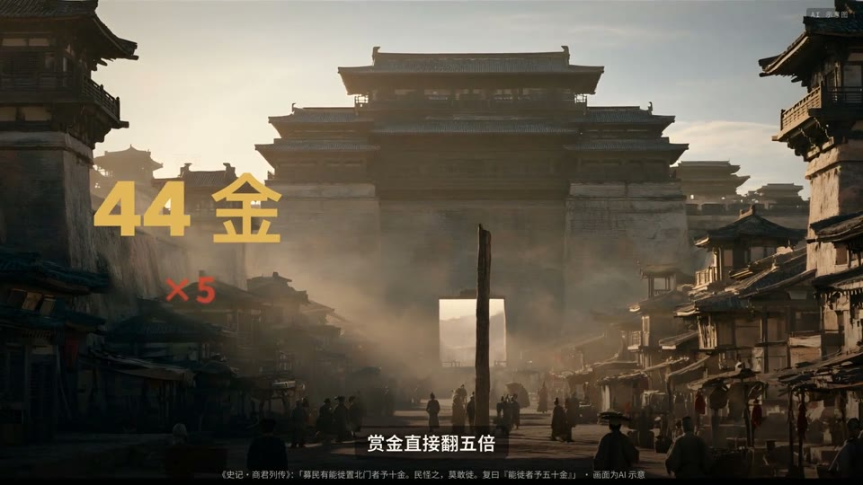
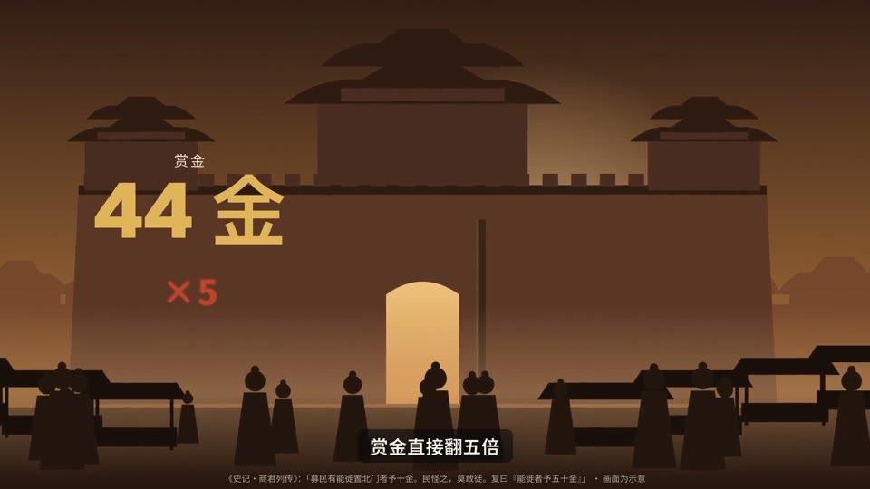
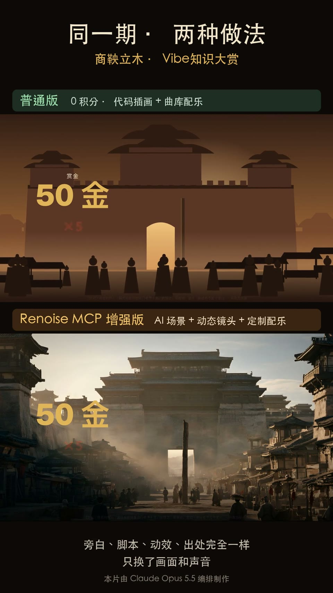
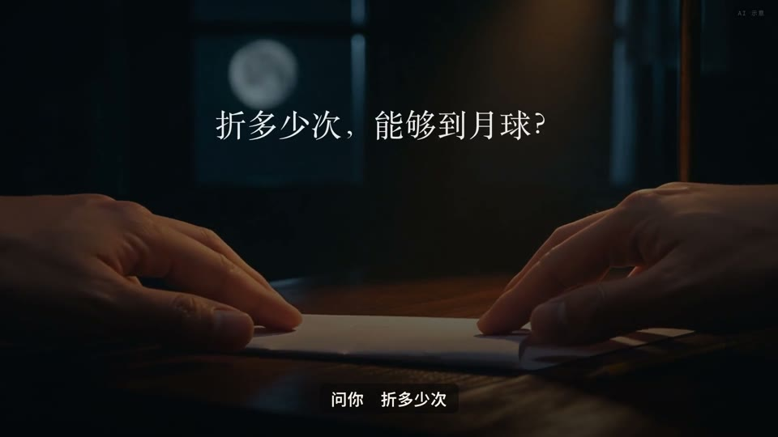
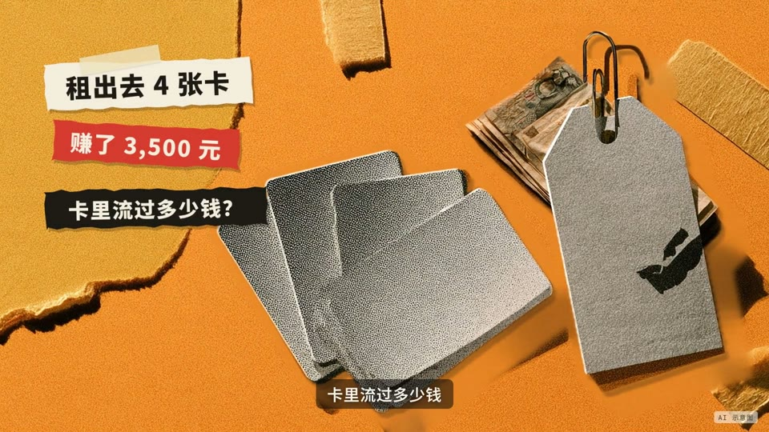
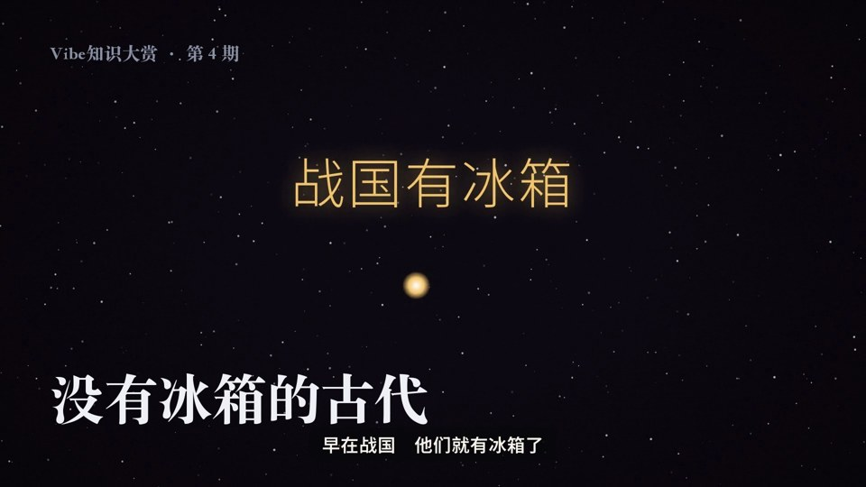
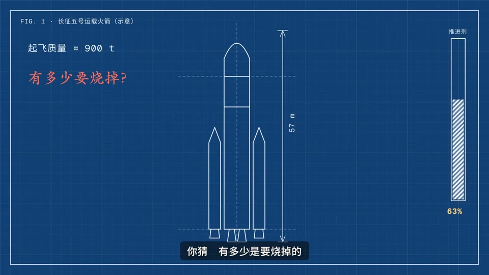
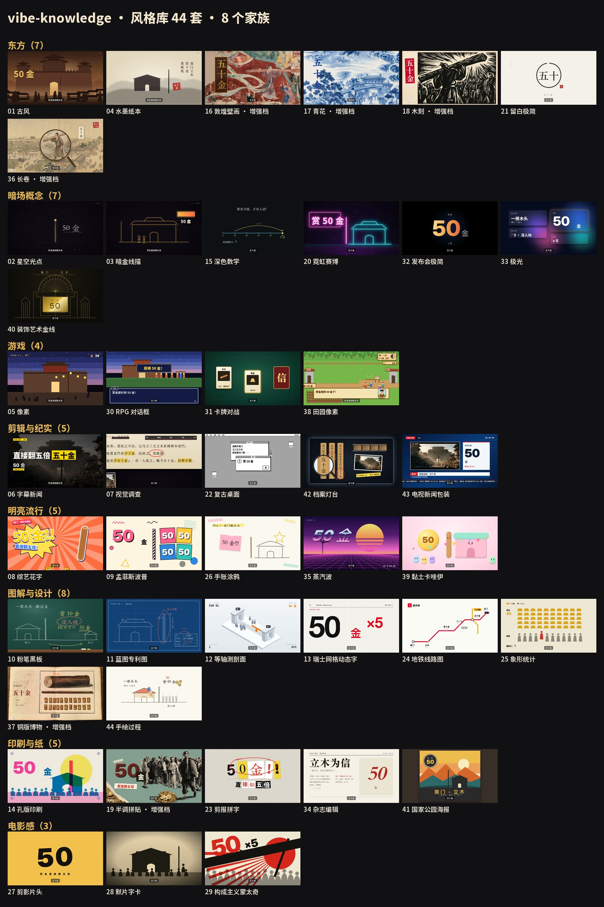

<div align="center">

# vibe-knowledge · Vibe 知识大赏

**一个知识点 → 一条有旁白、每句有出处的精品知识短片。**<br>
Claude Code skill：选题 → 查证 → 写稿 → 配音 → 代码成片 → 1080p60 → 质检 → 发布包，全程在对话里完成。

[](LICENSE) [](skills/vibe-knowledge/SKILL.md)

<sub>本仓库基于 <a href="https://github.com/andyhuo520/vibe-knowledge">andyhuo520/vibe-knowledge</a>（原作者 <a href="https://x.com/berryxia">@Berryxia</a>）修改，由 <a href="https://github.com/linyqh">@linyqh</a> 维护：配音改用本机 BreezeCast，逐字对齐与回读改用本机 Murmur，换曲只用自备文件或本机 Songhearth，不再依赖云端语音服务和密钥。改动记录见 <a href="skills/vibe-knowledge/CHANGELOG.md">CHANGELOG</a>。</sub>

[English](README.en.md) · [看样片](#看样片) · [风格库](#风格库44-套--8-个家族) · [听一听](#听一听默认-bgm) · [增强档](#增强档生图动态镜头音效) · [安装](#安装)


<sub>↑ 风格快闪片节选。完整 42 秒版：<a href="https://github.com/andyhuo520/vibe-knowledge/releases/download/v1.0.0/style-flash-42s.mp4">style-flash-42s.mp4</a></sub>

</div>

---

## 看样片

点封面播放（视频放在上游仓库的 [Release v1.0.0](https://github.com/andyhuo520/vibe-knowledge/releases/tag/v1.0.0)，由原作者制作，配音不是本仓库的默认音色）。所有画面都由 Claude Opus 编排、代码逐帧渲染；标「增强」的镜头是 AI 生成的配图和动态镜头，片中都标注「AI 示意」。

<table>
<tr><td width="50%" valign="top"><a href="https://github.com/andyhuo520/vibe-knowledge/releases/download/v1.0.0/ep04b-no-fridge-gufeng.mp4"></a><br><b>如果你活在古代没有冰箱（古风版）</b><br><sub>2:05 · 两难选择片 · 古风 · 增强标准档（Wan 3.0 动态镜头）</sub></td><td width="50%" valign="top"><a href="https://github.com/andyhuo520/vibe-knowledge/releases/download/v1.0.0/ep01-shangyang.mp4"></a><br><b>商鞅立木：搬一根木头赏五十金，你搬不搬？</b><br><sub>2:32 · 两难选择片 · 古风 · 增强档</sub></td></tr>
<tr><td width="50%" valign="top"><a href="https://github.com/andyhuo520/vibe-knowledge/releases/download/v1.0.0/ep01-shangyang-base.mp4"></a><br><b>商鞅立木（基础档，0 费用）</b><br><sub>2:32 · 同一份 film.js，代码插画版</sub></td><td width="50%" valign="top"><a href="https://github.com/andyhuo520/vibe-knowledge/releases/download/v1.0.0/ep01-tiers-compare.mp4"></a><br><b>商鞅立木 · 两档上下对比</b><br><sub>2:32 · 基础档 vs 增强档，旁白和脚本完全一样</sub></td></tr>
<tr><td width="50%" valign="top"><a href="https://github.com/andyhuo520/vibe-knowledge/releases/download/v1.0.0/ep02-paper-to-moon.mp4"></a><br><b>一张纸折多少次能到月球</b><br><sub>1:10 · 猜谜概念片 · 深色数学 + 尺度穿越 · 增强标准档</sub></td><td width="50%" valign="top"><a href="https://github.com/andyhuo520/vibe-knowledge/releases/download/v1.0.0/ep03-money-laundering.mp4"></a><br><b>什么是洗钱</b><br><sub>1:31 · 痛点原理片 · 半调拼贴 · 增强轻档</sub></td></tr>
<tr><td width="50%" valign="top"><a href="https://github.com/andyhuo520/vibe-knowledge/releases/download/v1.0.0/ep04-no-fridge.mp4"></a><br><b>如果你活在古代没有冰箱</b><br><sub>3:12 · 猜谜概念片 · 星空光点 · 基础档 0 费用（同一选题的另一种讲法）</sub></td><td width="50%" valign="top"><a href="https://github.com/andyhuo520/vibe-knowledge/releases/download/v1.0.0/ep05-rocket.mp4"></a><br><b>火箭怎么飞上天</b><br><sub>1:46 · 猜谜概念片 · 蓝图专利图 · 增强标准档</sub></td></tr>
</table>

**风格样片集**（每套风格演同一段「商鞅立木」开场，方便横向比较）：

- [最早 7 套（古风、星空光点、暗金线描、水墨纸本、像素、字幕新闻、视觉调查）](https://github.com/andyhuo520/vibe-knowledge/releases/download/v1.0.0/styles-01-core7.mp4)
- [剪辑与纪实](https://github.com/andyhuo520/vibe-knowledge/releases/download/v1.0.0/styles-02-edit-doc.mp4)
- [补空白家族 8 套](https://github.com/andyhuo520/vibe-knowledge/releases/download/v1.0.0/styles-03.mp4)
- [增强档：敦煌、青花、木刻、半调拼贴](https://github.com/andyhuo520/vibe-knowledge/releases/download/v1.0.0/styles-04-enhanced.mp4)
- [第五批 8 套](https://github.com/andyhuo520/vibe-knowledge/releases/download/v1.0.0/styles-05.mp4)
- [第六批 8 套](https://github.com/andyhuo520/vibe-knowledge/releases/download/v1.0.0/styles-06.mp4)
- [增强档：长卷、铜版博物](https://github.com/andyhuo520/vibe-knowledge/releases/download/v1.0.0/styles-07-enhanced.mp4)
- [田园像素](https://github.com/andyhuo520/vibe-knowledge/releases/download/v1.0.0/styles-08-farm-pixel.mp4)
- [第九批 5 套](https://github.com/andyhuo520/vibe-knowledge/releases/download/v1.0.0/styles-09.mp4)
- [手绘过程（手 + 笔画给你看）](https://github.com/andyhuo520/vibe-knowledge/releases/download/v1.0.0/styles-10-sketch.mp4)

## 风格库：44 套 · 8 个家族



| 家族 | 数量 | 风格（点开看 STYLE.md：配色、字体、镜头语言、适合的选题） |
|---|---|---|
| 东方 | 7 | [古风](skills/vibe-knowledge/styles/gufeng/STYLE.md)、[水墨纸本](skills/vibe-knowledge/styles/paper/STYLE.md)、[敦煌壁画](skills/vibe-knowledge/styles/dunhuang/STYLE.md)（增强）、[青花](skills/vibe-knowledge/styles/qinghua/STYLE.md)（增强）、[木刻](skills/vibe-knowledge/styles/woodcut/STYLE.md)（增强）、[留白极简](skills/vibe-knowledge/styles/minimal/STYLE.md)、[长卷](skills/vibe-knowledge/styles/scroll/STYLE.md)（增强） |
| 暗场概念 | 7 | [星空光点](skills/vibe-knowledge/styles/starfield/STYLE.md)、[暗金线描](skills/vibe-knowledge/styles/darkgold/STYLE.md)、[深色数学](skills/vibe-knowledge/styles/darkmath/STYLE.md)、[霓虹赛博](skills/vibe-knowledge/styles/neon/STYLE.md)、[发布会极简](skills/vibe-knowledge/styles/keynote/STYLE.md)、[极光](skills/vibe-knowledge/styles/aurora/STYLE.md)、[装饰艺术金线](skills/vibe-knowledge/styles/deco/STYLE.md) |
| 游戏 | 4 | [像素](skills/vibe-knowledge/styles/pixel/STYLE.md)、[RPG 对话框](skills/vibe-knowledge/styles/rpg/STYLE.md)、[卡牌对战](skills/vibe-knowledge/styles/cards/STYLE.md)、[田园像素](skills/vibe-knowledge/styles/farm/STYLE.md) |
| 剪辑与纪实 | 5 | [字幕新闻](skills/vibe-knowledge/styles/caption-news/STYLE.md)、[视觉调查](skills/vibe-knowledge/styles/investigation/STYLE.md)、[复古桌面](skills/vibe-knowledge/styles/desktop/STYLE.md)、[档案灯台](skills/vibe-knowledge/styles/lighttable/STYLE.md)、[电视新闻包装](skills/vibe-knowledge/styles/tvnews/STYLE.md) |
| 明亮流行 | 5 | [综艺花字](skills/vibe-knowledge/styles/variety/STYLE.md)、[孟菲斯波普](skills/vibe-knowledge/styles/memphis/STYLE.md)、[手账涂鸦](skills/vibe-knowledge/styles/journal/STYLE.md)、[蒸汽波](skills/vibe-knowledge/styles/vapor/STYLE.md)、[黏土卡哇伊](skills/vibe-knowledge/styles/clay/STYLE.md) |
| 图解与设计 | 8 | [粉笔黑板](skills/vibe-knowledge/styles/chalk/STYLE.md)、[蓝图专利图](skills/vibe-knowledge/styles/blueprint/STYLE.md)、[等轴测剖面](skills/vibe-knowledge/styles/isometric/STYLE.md)、[瑞士网格动态字](skills/vibe-knowledge/styles/swiss/STYLE.md)、[地铁线路图](skills/vibe-knowledge/styles/metro/STYLE.md)、[象形统计](skills/vibe-knowledge/styles/isotype/STYLE.md)、[铜版博物](skills/vibe-knowledge/styles/copper/STYLE.md)（增强）、[手绘过程](skills/vibe-knowledge/styles/sketch/STYLE.md) |
| 印刷与纸 | 5 | [孔版印刷](skills/vibe-knowledge/styles/riso/STYLE.md)、[半调拼贴](skills/vibe-knowledge/styles/collage/STYLE.md)（增强）、[剪报拼字](skills/vibe-knowledge/styles/ransom/STYLE.md)、[杂志编辑](skills/vibe-knowledge/styles/editorial/STYLE.md)、[国家公园海报](skills/vibe-knowledge/styles/poster/STYLE.md) |
| 电影感 | 3 | [剪影片头](skills/vibe-knowledge/styles/titles/STYLE.md)、[默片字卡](skills/vibe-knowledge/styles/silent/STYLE.md)、[构成主义蒙太奇](skills/vibe-knowledge/styles/constructivist/STYLE.md) |

「增强」= 需要 generate_image 生图（每段约 2 张），其余全部代码生成、0 费用。给出选题后，`recommend.py` 会推荐 3 套风格；你也可以从空白开始定一套自己的风格（`references/09-style-studio.md`）。

## 听一听：默认 BGM

默认旁白是 BreezeCast 设计出来的 AI 声音「AI博主沉稳男声」，不是真人，第一次使用时在你本机创建（见下方安装）；这里只放默认 BGM。

| 音频 | 说明 |
|---|---|
| [vibe-bgm.m4a](skills/vibe-knowledge/assets/music/vibe-bgm.m4a) | 默认 BGM（112.9 BPM，160 秒），每条视频都会用 |

**BGM 是强制的**：混音时如果 film.js 没放 BGM，会按片长自动裁一份补上；别的整段配乐会被停用；音量统一校准到「说话时比人声低 10 dB」。只有用户明确要求换曲才换（音乐条目写 `bgm: true, user_request: "用户原话"`），换曲来源只有两种：自备音频文件，或本机 Songhearth 生成，都用 `tools/swap_bgm.py`（`--file 歌.mp3` 或 `--songhearth "英文风格标签"`），输出 `bgm_user.wav`。

## 它怎么做一期

| 段 | 做什么 |
|---|---|
| ① 选题 | 3 秒内能不能让人先猜 / 先选？有没有贯穿全片的道具？有没有反转？ |
| **确认 1** | 选题、6 种母版之一、**时长**（按复杂度给四档：速览 / 精讲 / 标准 / 深挖，每档写清能讲多细、要砍掉什么）、风格、档位 |
| ② 查 | 事实清单 `facts.md`：每个数字、人名、年份、引文都有出处；说法有分歧时两说并列 |
| ③ 写 | 按母版写旁白 → 子 agent 对抗审查（钩子、出处、字数）→ 改 |
| **确认 2** | 看旁白稿 + 分镜（增强档附带镜头清单、提示词和报价），同意后才生成 |
| ④ 配音 | BreezeCast 本机设计音色 + Murmur 本机逐字对齐 + 回读校验 + 人声后期 |
| ⑤ 编 | `film.js`：组件库 `know.js`（配图推拉、逐帧视频、关键词、计数器、竖排古文、出处脚注、两难按钮、印章、线稿剖面图…）|
| ⑥ 渲 | 1080p60 逐帧录制 → 混音（强制 BGM、按人声校准）→ 封面接成开头帧 |
| ⑦ 质检 | 接触表 + OCR 回读对照 facts.md + 响度 + 冻结检测 + BGM 检测 |
| **确认 3** | 看成片 → 发布包（标题、话题、简介、封面） |

**两档制作**：基础档 0 费用（Opus 手写 SVG 分层插画、粒子、数据组件）；增强档只把代码做不好的镜头（写实场景、最需要被记住的 1–3 个时刻）交给生图和动态镜头，每次先报价、你同意了才生成。同一份 film.js 两档通用。

**六种母版**：猜谜概念片、两难选择片、痛点原理片、一条主线片、闯关片、六面轮转片（`references/01-templates.md`）。

## 增强档：生图、动态镜头、音效

增强档只负责代码做不好的那几个镜头：写实的时代场景配图、最需要被记住的 1–3 个动态镜头、个别音效。其余画面照样用代码画。**基础档完全不需要下面这些，0 费用就能出片。**

- **配图**：omp 内置的 `generate_image`，用 omp 里配置的图像模型生成，每段约 2 张。
- **动态镜头**：omp 的 `xai_generate_video`（xAI Grok Imagine），按输出秒数和分辨率计费：默认 `grok-imagine-video` 720p $0.07/秒（实测 8 秒一条 $0.56），更贵的 `grok-imagine-video-1.5` 720p $0.14/秒、1080p $0.25/秒（2026-11-17 价格，以 [xAI 官方模型页](https://docs.x.ai/developers/models)为准）。
- **音效**：本机 Songhearth，`tools/gen_sfx.py` 按 assets.json 批量生成，0 费用、无需密钥。
- **先报价、你点头才生成**：每一期都会把要生成的镜头、提示词、视频秒数 × 单价列给你，你在对话里明确同意才开始任何付费生成。
- **片中标注**：AI 生成的画面都会标「AI 示意」。

## 安装

```bash
git clone https://github.com/linyqh/vibe-knowledge.git
cp -R vibe-knowledge/skills/vibe-knowledge vibe-knowledge/skills/ai-teardown ~/.claude/skills/
```

- `vibe-knowledge` 是本体；`ai-teardown` 提供 cine 渲染引擎、建工作区和配音脚本，两个都要装。
- 渲染用的 Python：`python3 -m venv ~/.venvs/cine && ~/.venvs/cine/bin/pip install numpy scipy pillow playwright && ~/.venvs/cine/bin/python -m playwright install chromium-headless-shell`，再 `export CINE_PY=~/.venvs/cine/bin/python`。
- `ffmpeg`；OCR 质检用 macOS 自带的 Vision（需要 `swiftc`）。
- 配音：本机 BreezeCast（BreezeTTS 2，不需要任何密钥，0 费用）。要求：BreezeCast 已打开、引擎就绪、已装一个 BreezeTTS 2 模型（默认 `breeze_tts_2_q8_0`，5.1 GB，在 App 里下载）；另需本机 Murmur（逐字对齐与回读，Qwen3-ASR 模型，也不需要密钥）：App 已打开，「API 接口」页启用 API 服务（127.0.0.1:7895），并加载一个带词级时间戳的模型。Murmur 必须和脚本在同一台 Mac 上（传的是文件路径，不上传），每拍的转写会出现在 Murmur 的历史里。BreezeCast 在局域网另一台 Mac 上时：`export BREEZECAST_URL=http://<IP>:17860`。
- 第一次用要先在你自己的 BreezeCast 里建好默认音色「AI博主沉稳男声」（仓库不带任何音频）：`python3 ~/.claude/skills/ai-teardown/engine/scripts/voice_audition.py ~/.claude/skills/vibe-knowledge/assets/voice/default-voice.json <试听目录>` 出几条候选，听完选一条，再加 `--save <take id> --name AI博主沉稳男声` 存成 BreezeCast 音色。想用自己的声音：先在 BreezeCast 里克隆（App 里操作，或 breezecast skill 的 `voice-clone --name X --audio ref.wav --ref-text "录音逐字稿"`；单人干净录音 3–20 秒，逐字稿要一字不差，只用你本人或已获授权的声音），再 `new_film.py … --voice X`。
- 增强档（可选）：需要在 omp 里运行（用到 `generate_image` 和 `xai_generate_video` 两个工具，xAI 密钥在 omp 里配置），并且本机 Songhearth 已装音效模型（`moss-soundeffect-v2` 或 `stable-audio-3-small-sfx`）。详见上面的 [增强档](#增强档生图动态镜头音效) 一节。

然后在 Claude Code 里说：

> 做一期知识大赏：为什么假账总被数字 1 出卖？

第一次用会先打开本地「风格图鉴」，介绍母版、风格和档位。

## 目录

```
skills/vibe-knowledge/   本体：SKILL.md、references/（14 份规范与踩坑）、styles/（44 套风格）、kit/know.js、tools/、templates/、assets/（默认 BGM、默认音色设计清单）
skills/ai-teardown/      cine 引擎（three.js 逐帧渲染）、字体、图标集、建工作区和配音脚本
docs/                    README 用的封面、风格墙、动图
```

## 致谢

做这个项目时参考过 lemo-opuscar、huashu-art-motion、paper2video、Paper-Cut、LuZhong-Li/vibe-knowledge-video-skill、earshot 等开源项目。每个项目参考了什么、用在哪里、什么许可证，都列在 [ACKNOWLEDGEMENTS.md](ACKNOWLEDGEMENTS.md)。如有不准确的地方，欢迎到 [本仓库 issue](https://github.com/linyqh/vibe-knowledge/issues) 反馈，我们会及时更正。

## 许可

代码以 [MIT](LICENSE) 开源，保留原作者的版权声明。示例视频、AI 生成的配图和动态镜头、默认 BGM 与默认音色的说明见 [NOTICE.md](NOTICE.md)；第三方组件见 [THIRD_PARTY.md](THIRD_PARTY.md)；参考过的开源项目见 [ACKNOWLEDGEMENTS.md](ACKNOWLEDGEMENTS.md)。

原作者 [@Berryxia](https://x.com/berryxia)（[andyhuo520/vibe-knowledge](https://github.com/andyhuo520/vibe-knowledge)）· 本仓库维护 [@linyqh](https://github.com/linyqh) · 用 Claude Code（Claude Opus）编排制作
